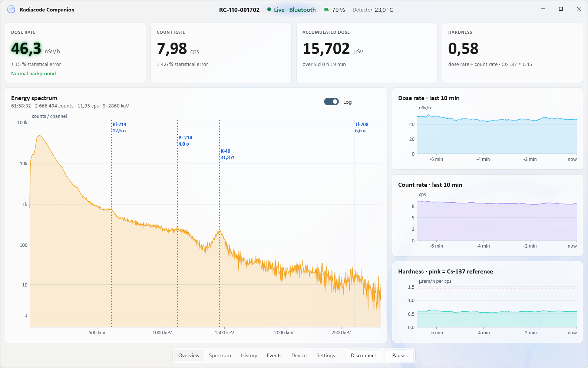
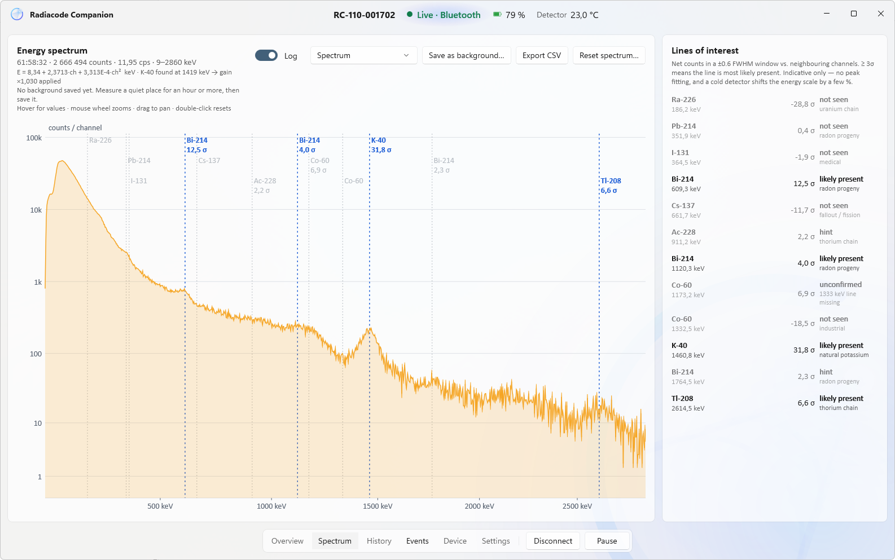
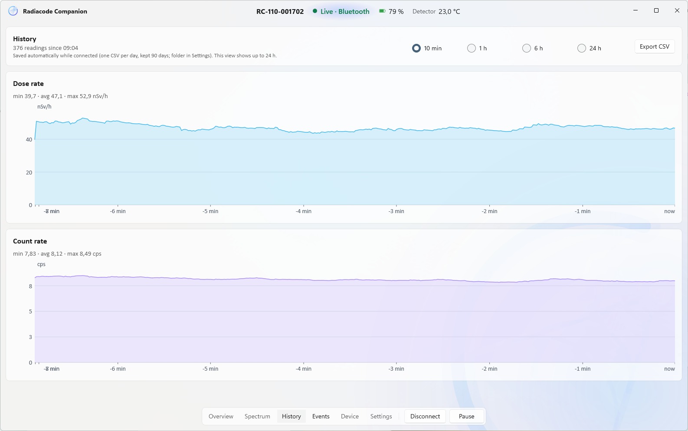
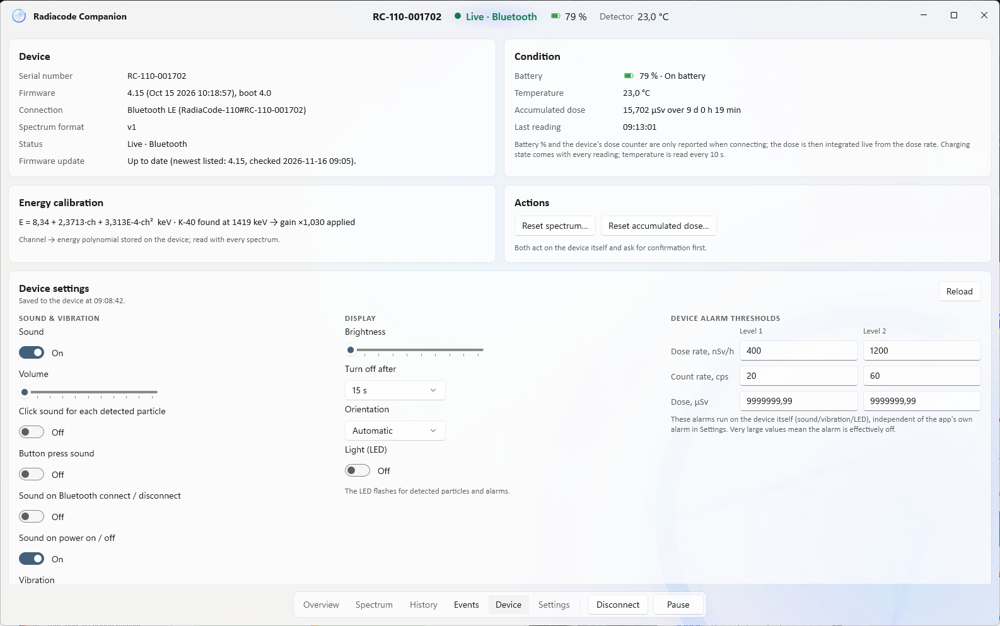
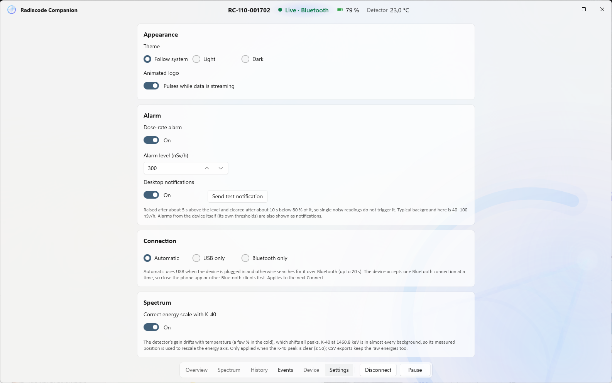

# Radiacode Companion (unofficial)

Cross-platform desktop app for RadiaCode-10x/110 radiation detectors — Windows (WinUI) and Linux (Uno Platform, Skia).
Not affiliated with Radiacode Ltd.

Live dose rate, count rate and energy spectrum over **USB or Bluetooth LE**, isotope line hints, K-40 gain
self-calibration, background comparison, dose-rate alarms with desktop notifications, history saved to disk,
CSV export and a firmware-update check.



| Spectrum | History |
|---|---|
|  |  |
| **Device** | **Settings** |
|  |  |


## Layout

| Project | Purpose |
|---|---|
| `src/Radiacode.Core` | Protocol, decoders, spectrum analysis (pure .NET, no platform code) |
| `src/Radiacode.Transport.LibUsb` | USB transport via libusb-1.0 (WinUSB backend on Windows) |
| `src/Radiacode.Transport.Ble` | Bluetooth LE transport (WinRT on Windows, BlueZ/D-Bus on Linux) |
| `src/Radiacode.App` | The app (Uno single project: `net10.0-windows10.0.26100`, `net10.0-desktop`) |
| `src/Radiacode.Cli` | Console tool (`rccli`): `info`, `live`, `spectrum`, `list`, debug commands |
| `tests/Radiacode.Core.Tests` | Unit tests, incl. frames captured from a real RC-110 |
| `packaging/linux` | `.deb` builder, desktop entry, udev rule |

## Builds

GitHub Actions (`.github/workflows/build.yml`) builds on every push:

- Windows `win-x64` and `win-arm64` — installer `_setup.exe` (per user, no admin rights needed)
- Windows Microsoft Store packages (`.msix`, unsigned; the Store signs them) as separate build artifacts
- Linux `linux-x64` and `linux-arm64` — `.deb`

Pushing a tag `vX.Y.Z` creates a GitHub release with all files and `SHA256SUMS.txt`.

## Install on Linux (APT repository, automatic updates)

Debian/Ubuntu, amd64 and arm64. Set up once; afterwards new versions come with `sudo apt upgrade` like the rest of the system:

```bash
sudo curl -fsSLo /usr/share/keyrings/radiacode-companion.gpg https://scien-00.github.io/RadiacodeCompanion/apt/radiacode-companion.gpg
echo "deb [signed-by=/usr/share/keyrings/radiacode-companion.gpg] https://scien-00.github.io/RadiacodeCompanion/apt stable main" | sudo tee /etc/apt/sources.list.d/radiacode-companion.list
sudo apt update && sudo apt install radiacode-companion
```

To let `unattended-upgrades` install new versions automatically too:

```bash
echo 'Unattended-Upgrade::Origins-Pattern { "origin=SCIENindustries,label=Radiacode Companion"; };' | sudo tee /etc/apt/apt.conf.d/52radiacode-companion
```

## Requirements

- **Windows:** the device must use the WinUSB driver for USB (Bluetooth needs nothing extra).
- **Linux:** the `.deb` installs a udev rule for USB access (`0483:f123`); Bluetooth uses BlueZ.
- Building: .NET 10 SDK (see `global.json`).

## License

GPL-3.0-or-later — see [LICENSE](LICENSE). You may use, modify and redistribute it, but distributed versions (including modified or sold ones) must stay under the GPL with their source available.

## Credits

Protocol and decoders ported from [cdump/radiacode](https://github.com/cdump/radiacode) (MIT).
libusb-1.0 binaries in `native/` are from the official libusb release (LGPL-2.1).
